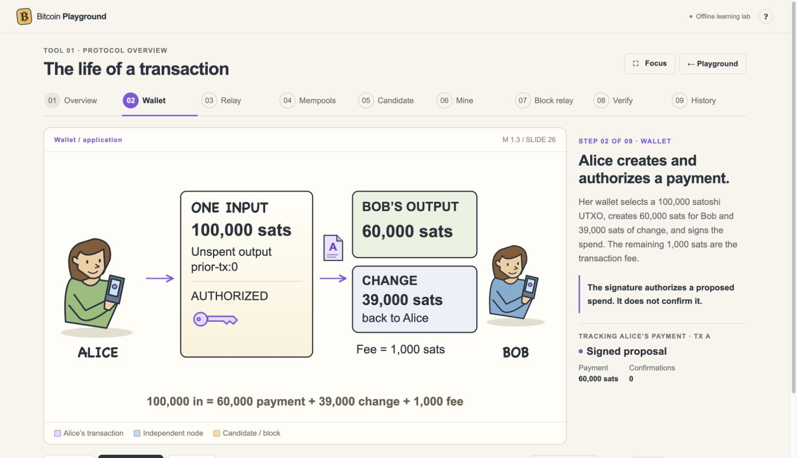
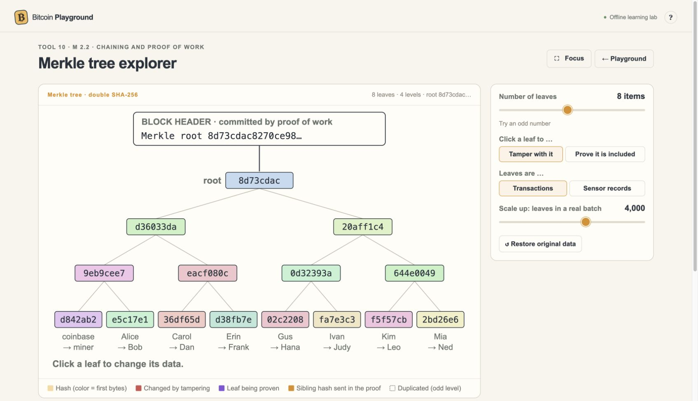
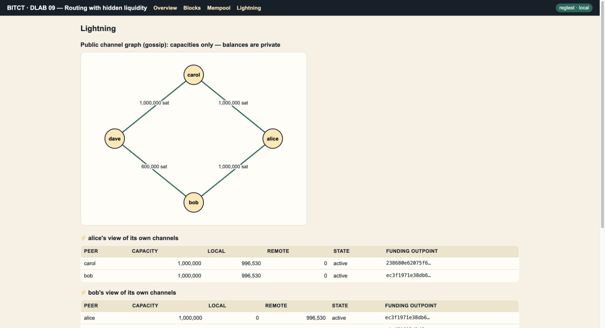
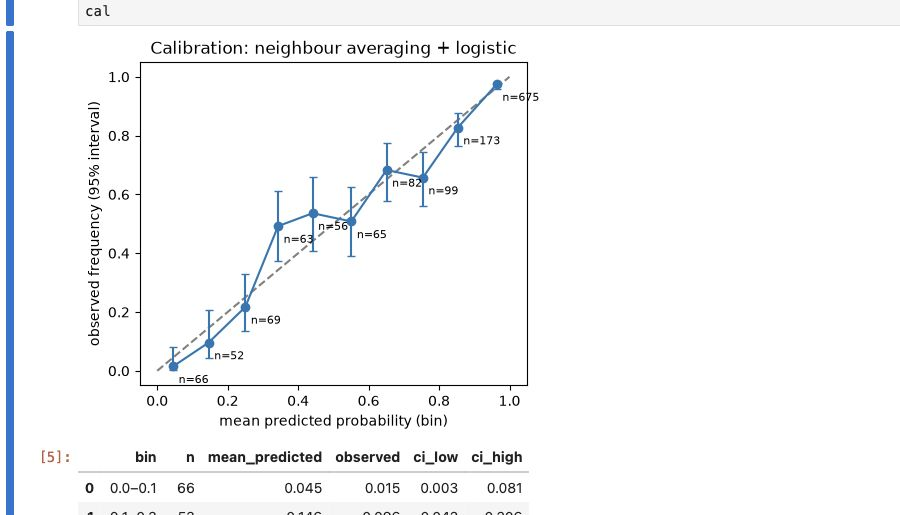
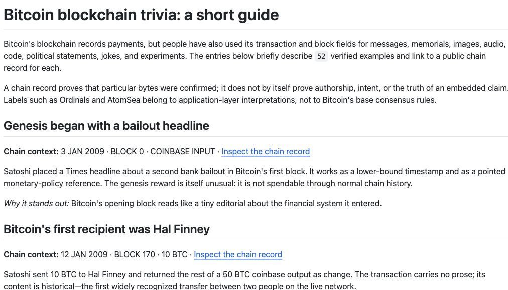
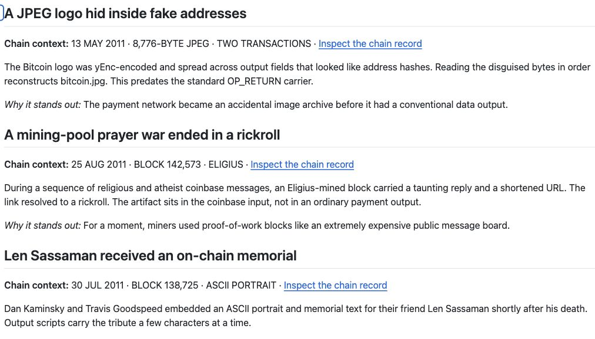

# bitct — Bitcoin course materials

Explore Bitcoin from three complementary angles: see how its mechanisms work, try them in a lab, and discover the history recorded on its blockchain.

The public course collection currently has three sections. Choose one below; its README contains the full guide and any setup instructions.

## Bitcoin Playground

A collection of 20 interactive visual tools for building intuition about Bitcoin. Follow a transaction, change a mining or fee parameter, explore a Merkle tree, and experiment with wallets or Lightning. These offline teaching simulations make the consequences visible without using real funds.

| A payment, step by step | Explore a Merkle tree |
|---|---|
|  |  |

[Explore the Playground →](course-materials/bitcoin-playground/README.md)

## Hands-on laboratories

Guided experiences that turn course ideas into experiments with Bitcoin, Lightning and verifiable sensor data. Work with local nodes and channels, inspect what happens, and investigate questions through a graph-learning notebook. The exercises use local test networks or explicitly labelled simulations.

| Lightning lab dashboard | Graph-learning notebook · simulation |
|---|---|
|  |  |

[Explore the laboratories →](course-materials/bitct-lab/README.md)

## Blockchain trivia

A guided tour of Bitcoin's unusual historical traces: early milestones, hidden messages, memorials and digital artifacts. The collection pairs a short guide to 52 examples with small reconstruction scripts, connecting each story to the public blockchain records behind it.

| Bitcoin's early milestones | Messages, memorials and artifacts |
|---|---|
|  |  |

[Explore the trivia collection →](course-materials/bitcoin-blockchain-trivia/README.md)

---

Original code and documentation: [MIT license](LICENSE). Third-party software and historical artifacts retain their respective rights.
